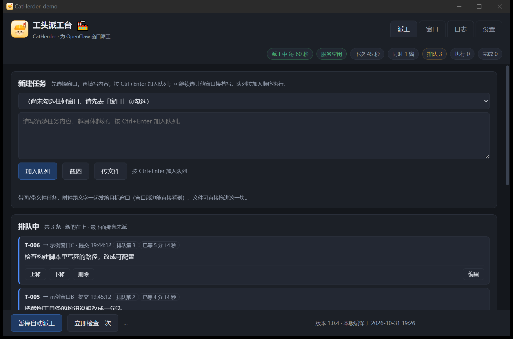
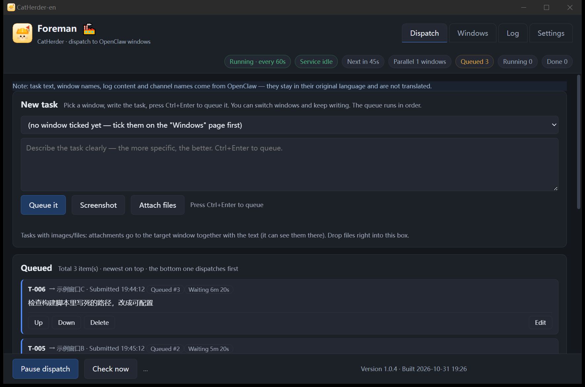
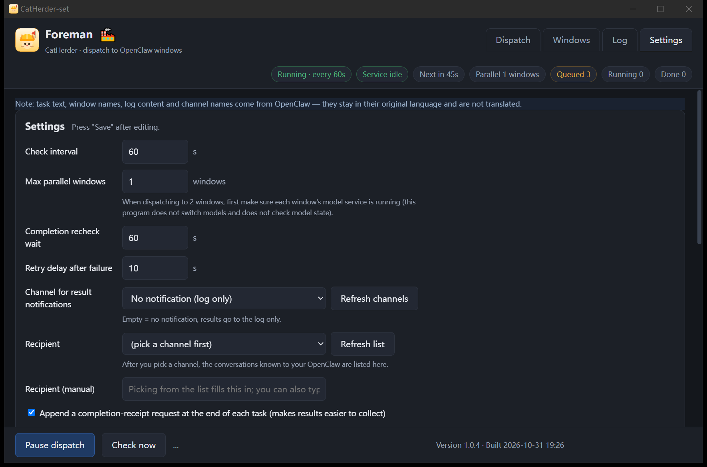

# Foreman CatHerder

**Dispatch and queue tool for OpenClaw windows**

Sends tasks to multiple OpenClaw session windows: one global queue, dispatched in order. A task goes out only when the target window is idle, the model service is idle and the GPU is idle. Queuing, dispatch, completion detection, result forwarding and automatic shutdown run without calling the model, without occupying a chat slot, and without spending tokens.

For anyone running a large local model with several windows working at the same time.

---

## 1. Why

A local deployment has a single inference service. Tasks from several windows can only be executed one at a time: if one task takes 1–2 hours, another waits 1–2 hours. During that wait, repeatedly sending follow-up messages tends to fail and tends to interrupt the run in progress.

Foreman replaces "a person watching and waiting" with "a queue":

- Tasks enter the queue first instead of being sent immediately.
- Dispatch happens only when window, model service and GPU are all idle.
- Completion is decided by the program; results are forwarded to the chat channel automatically.
- The user reviews results on a phone, then dispatches the next round.

Local model time stays fully used, and nobody has to sit at the machine.







### A real deployment

- Model: Qwen3.8-Flash-Next (125B MoE, about 6B active), run locally through Strata, IQ3_XXS quantisation (about 70.9 GB in two shards), a single RTX 3090 24G.
- Windows: several OpenClaw session windows (development, drawing, upgrades, operations), one model service.
- Notifications: Feishu. Finished results are forwarded there and reviewed on a phone.
- Result: once a round is dispatched everything sits in the queue and the operator can walk away; back later, review on the phone, dispatch the next round.

## 2. Features

**Dispatch and queue**

- One global queue executed in submission order; each task names its target window.
- Compose like a chat: pick a window, write the task, Ctrl+Enter to queue. Keep writing to other windows without waiting.
- Before dispatch: edit the text, change the target window, delete, move earlier or later.
- Queued cards show how long they have waited and why they have not gone out (window busy / service busy / GPU busy).
- Windows are discovered automatically and added to the dispatch list.

**Gates**

- Window idle: reads window status and pending inputs from the OpenClaw session database.
- Service gate: reads the model service busy / queued state.
- GPU gate: utilisation above the threshold for two consecutive checks holds dispatch back, which catches "service reports idle while the GPU is still working".
- Same-model conflicts ask for confirmation first, so two tasks do not fight over one service.

**Completion detection**

- Completion is judged on the window: terminal status + no pending input + a re-check after a delay (60 s by default).
- A task may ask the window to reply with an acknowledgement line (for example `✅T-012`). Missing acknowledgement does not block the queue; the card is greyed as "unconfirmed".

**Result forwarding**

- Finished results are sent to a chat channel (Feishu / Telegram and others; channel auto-detected, selectable, can be turned off).
- Works with no channel installed: choose "no notifications" and everything else keeps running.

**Screenshots and files**

- Built-in capture: drag a region, then pen / rectangle / ellipse / arrow / text / mosaic / colour picker, three stroke widths, undo, redo, save as.
- Captures and files land in a pending area first, so a note can be added before queuing; attachments travel to the target window with the task.

**Automatic shutdown**

- Shuts down after the queue empties and everything is done, with a delay; new activity cancels it automatically.
- Optional time window. The shutdown command forces, so programs that block shutdown cannot stall it.

**Other**

- Chinese / English interface, applied on save. Data coming from OpenClaw (task text, window names, log entries, channel names) stays in its original language.
- Log page records every dispatch, completion and failure; CSV export with UTF-8 BOM opens directly in WPS.
- Any failure halts dispatch with a red banner; "Retry this" or "Resume".
- Single portable exe, double-click to run, copy it anywhere; optional autostart and taskbar icon.
- Version and build time shown at the bottom of the window, so it is obvious which build is running.

## 3. Requirements

- OpenClaw gateway running on the same machine (port 18789 by default; read from `~/.openclaw/openclaw.json`).
- Model service status is optional: Foreman can read a service status endpoint (for example Strata's `/status`); if it cannot, it falls back to window state only.
- A chat channel is optional.
- Automatic shutdown uses the Windows command (`shutdown /s /t 0 /f`); other systems are not adapted, leave it off there.

## 4. Install and run

1. Download `catherder-gui.exe` from Releases (portable single file, about 16 MB).
2. Run it. Session database path and gateway port are located automatically; fill them in Settings if they are not found.
3. Data defaults to `catherder\catherder.sqlite` under the user config directory (on Windows `%APPDATA%\catherder\catherder.sqlite`). Use `-data <path>` for a separate database and `-id <name>` for a separate single-instance lock, so two copies can run side by side.

The command line build shares the same logic as the GUI:

```
catherder.exe queue            show the queue
catherder.exe status           settings, gates, pending confirmations
catherder.exe log              recent events
catherder.exe export           export CSV
catherder.exe tick             run one check now
catherder.exe add / move / cancel / errors / retry / confirm / scan / set / get / notify / shot
```

## 5. Build from source

```
cd app
go build -tags production -trimpath -ldflags "-s -w" -o bin/catherder.exe .
go build -tags production,wv2runtime.browser -trimpath -ldflags "-s -w -H=windowsgui" -o bin/catherder-gui.exe .
```

- Go 1.27 or newer, Wails v2. The front end is plain HTML/CSS/JS, embedded in the exe; no npm build step.
- Tested on Windows 10/11. On other systems tray, autostart, the GPU gate and screen capture compile to no-ops; the Linux GUI needs webkit2gtk and has not been tested.
- The version string comes from the `VERSION` file at the project root and is injected at build time.
- Tests: `go test ./internal/...`.

## 6. Layout

```
app/            Go source and front-end assets
  main.go       single entry point: subcommands run the CLI, otherwise the GUI starts
  internal/     engine / openclaw (read + dispatch) / store / app (GUI bridge) / screen / cli
  frontend/dist interface (app.js / shot.js / i18n.js / index.html / app.css)
tools/          development scripts: build, GUI self-check, translation checks, ledger, release packaging
root .md files  design, interface measurements, milestone acceptance, term list, release runbook (development records, not user docs)
```

## 7. Known limits

- Completion detection depends on the window status field in the OpenClaw session database. If that field is left in an abnormal state, a window can show "running" for a long time; sending one message in that window clears it.
- The GPU gate uses Windows performance counters (`nvidia-smi` as fallback); disabled on other systems.
- The shutdown command is the Windows one; other systems are not adapted.
- One model service runs one task at a time. Parallel work needs several service instances.
- Language switching covers interface text only; content from OpenClaw is not translated.

## 8. Licence

MIT. See LICENSE.
