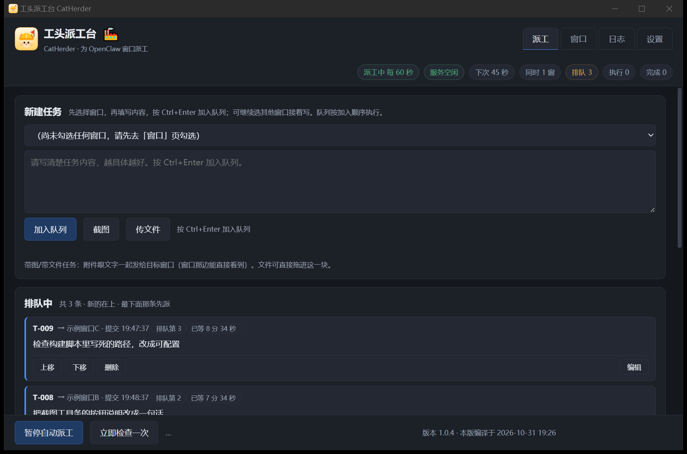
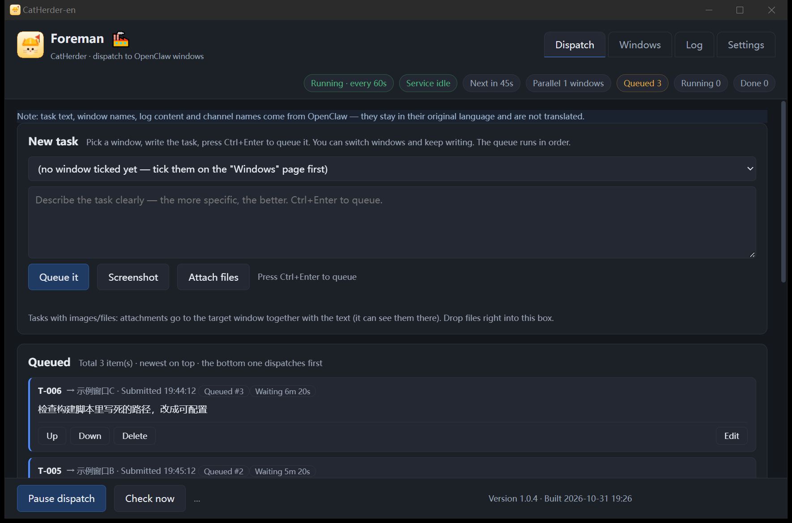
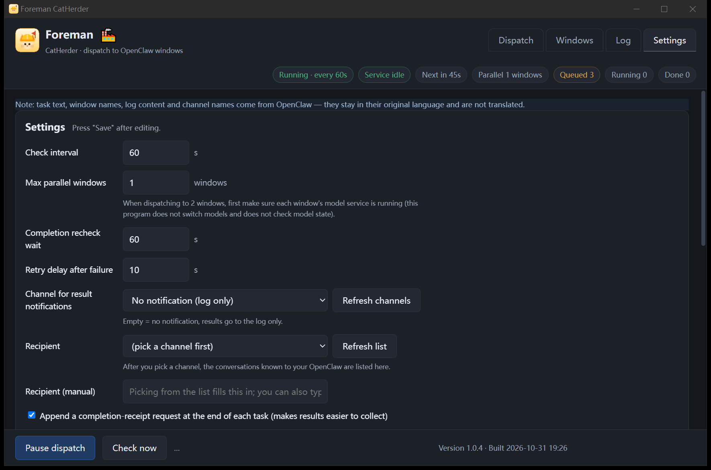

# 工头派工台 CatHerder

[English](README.md) | **中文说明**

**OpenClaw 多窗口派工与排队工具**

给 OpenClaw 的多个会话窗口派任务：一条全局队列，按顺序派发；窗口空闲、模型服务空闲、显卡空闲才放行下一条。派发、排队、完工判定、结果转发、自动关机，全程不占模型、不占对话槽、不消耗 token。

适用对象：在本地跑大模型、同时开多个窗口干活的人。

---

## 一、为什么需要它

本地部署模型只有一个推理服务。多个窗口同时发任务，只能一个接一个做：一条任务跑 1–2 小时，另一条就得等 1–2 小时。等待期间反复发消息追问、催办，容易出错、容易打断正在跑的回合。

派工台把「人盯着等」换成「程序排队」：

- 任务先进队列，不直接发；
- 目标窗口空闲、模型服务空闲、显卡空闲，三者齐了才派发；
- 完工由程序判定，结果自动转发到聊天软件（飞书等）；
- 人在手机上验收，验收完再派下一轮。

本地模型的运行时间被填满，人不必守在电脑前。







### 一个实际部署的例子

- 模型：Qwen3.8-Flash-Next（125B MoE，激活约 6B），Strata 本地部署，IQ3_XXS 量化（约 70.9 GB，分两片），单张 RTX 3090 24G。
- 窗口：OpenClaw 开多个会话窗口（开发、绘图、升级、运维各一个），模型服务只有一个。
- 通知：飞书。完工结果自动转飞书，手机验收。
- 效果：一轮任务派完，队列里都在排队，人就可以离开；回来在手机上验收，验收完再派下一轮。

## 二、主要功能

**派工与排队**

- 全局一条队列，按提交先后执行；每条任务标明目标窗口。
- 像聊天一样录入：选窗口 → 写内容 → Ctrl+Enter 入队。可连续给多个窗口写，不必等前一条跑完。
- 未派发前可反悔：改正文、换目标窗口、删除、上移／下移调序。
- 排队中显示已等时长与未派发的原因（窗口忙／服务忙／显卡忙）。
- 窗口自动检索列出，勾上「新扫到的窗口自动纳入」后自动列入可派工名单（该开关默认关，未勾时手动勾选）。

**放行闸门**

- 窗口空闲判定：读 OpenClaw 会话库的窗口状态与待处理输入，不看模型服务脸色。
- 服务闸门：读模型服务的忙／排队状态。
- 显卡闸门：利用率连续两轮超阈值先不派，挡住「服务不报忙但显卡还在动」的误判。
- 同模型并发时先请求确认，避免两条任务抢同一个服务。

**完工判定与回执**

- 判完工看窗口：状态终结 + 无待处理输入 + 延时复核（默认 60 秒）。
- 任务正文可要求窗口回一行回执（如 `✅T-012`）；未回回执照常推进，卡片标灰「疑似未确认」，不卡队列。

**结果转发**

- 完工结果自动发到聊天软件（飞书／Telegram 等，自动探测通道，可下拉选择，可关闭）。
- 没装通道也能用：选「不用通知」，照常干活。

**带图任务**

- OpenClaw 网页端只能发文件和图片，不能直接截屏。派工台自带截图工具：拖框选区，画笔／方形／椭圆／箭头／文字／马赛克／取色器，粗细三档，撤销重做、另存为。
- 截图与文件先进待发区，可补文字再入队；附件随任务一起发到目标窗口，模型直接读图。派视觉类任务不用在几个程序之间倒图。

**自动关机**

- 队列清空、全部完工后延时关机；期间有新活动自动撤销。
- 可设时段；关机命令带强制，避免被挡关机的程序卡住。

**其他**

- 界面中英文可切，保存即生效。OpenClaw 传来的数据（任务正文、窗口名、日志、通道名）保持原文，不翻译。
- 日志页记录每次派发、完工、异常；可导出 CSV（带 UTF-8 BOM，WPS 直接打开）。
- 异常统一停机，界面红横幅提示，可「重试这条」或「继续派发」。
- 免安装单文件 exe，双击即用，拷走即用；可选开机自启、常驻任务栏图标。
- 版本号与本版编译时刻显示在界面底部，便于确认跑的是哪一版。

## 三、使用前提

- 本机已运行 OpenClaw 网关（默认端口 18789，自动读取 `~/.openclaw/openclaw.json`）。
- 模型服务状态可选：服务状态地址在设置页填（默认 `http://127.0.0.1:8080`）。它会按服务自己会的问法去问忙闲：`/status`（`{"busy":…,"queued":…}`，Strata 那类路由与不少代理）、`/slots`（llama.cpp 的 llama-server）、`/api/ps`（ollama）、`/running`（llama-swap，会再追一层问它代管的那个服务）。四种都没答就自动降级，只看窗口状态（界面「服务」那一栏会显示「未知」，悬停写明原因）。
- 通知通道可选。
- 自动关机为 Windows 写法（`shutdown /s /t 0 /f`），其它系统未适配，请勿开启。

## 四、安装与运行

1. 下载 Releases 里的 `catherder-gui.exe`（免安装单文件，约 16 MB）。
2. 双击运行。首次运行自动定位 OpenClaw 会话库与网关端口；读不到时在「设置」页填。
3. 数据默认存在用户配置目录下的 `catherder\catherder.sqlite`（Windows 即 `%APPDATA%\catherder\catherder.sqlite`）。可用 `-data <路径>` 指定独立库，配合 `-id` 给每份自己的单实例锁号，两份可同时跑、互不干扰。

没有任何东西写死在本机：OpenClaw 配置路径按用户目录推导，会话库与网关端口运行时自动定位，聊天通道从该配置里读，模型服务地址是设置项。换机器不用改代码，自动定位没读到时在设置页填。

命令行版 `catherder.exe` 与界面版共用同一套逻辑：

```
catherder.exe queue            查看队列
catherder.exe status           当前设置、闸门、待确认
catherder.exe log              最近事件
catherder.exe export           导出 CSV
catherder.exe tick             立即检查一次
catherder.exe add / move / cancel / errors / retry / confirm / scan / set / get / notify / shot
```

## 五、从源码构建

```
cd app
go build -tags production -trimpath -ldflags "-s -w" -o bin/catherder.exe .
go build -tags production,wv2runtime.browser -trimpath -ldflags "-s -w -H=windowsgui" -o bin/catherder-gui.exe .
```

- Go 1.27 以上，Wails v2。前端为纯原生 HTML/CSS/JS，已嵌入 exe，无需 npm 构建。
- 实测平台为 Windows 10/11。非 Windows 下托盘、开机自启、显卡闸门、截图走空实现；Linux 界面版需 webkit2gtk，未实测。
- 版本号读项目根下的 `VERSION`，编译时注入界面显示。
- 测试：`go test ./internal/...`。

## 六、目录

```
app/            Go 源码与前端资源
  main.go       唯一入口：带子命令走命令行，否则开界面
  internal/     engine 引擎 / openclaw 读库与派发 / store 任务库 / app 界面接口 / screen 截图 / cli 命令行
  frontend/dist 界面（app.js / shot.js / i18n.js / index.html / app.css）
  assets/       任务栏图标
media/screenshots  上面三张图
```

开发脚本、设计记录、验收记录不进发布仓库；贡献者只需上面那两条编译命令。

## 七、已知限制

- 完工判定依赖 OpenClaw 会话库的窗口状态字段。该字段异常残留时，窗口会长期显示「执行中」；此时在该窗口发一句话让它跑一回合即可恢复。
- 显卡闸门依赖 Windows 性能计数器（`nvidia-smi` 兜底），非 Windows 关闭。
- 自动关机命令是 Windows 写法，其它系统未适配。
- 一个模型服务同一时刻只跑一条任务；要多条并发需自行部署多个服务实例。
- 界面语言切换只覆盖界面文字，OpenClaw 传来的内容不翻译。

## 八、许可

MIT。见 LICENSE。要求署名：副本里保留版权声明与许可文字，引用或介绍时注明项目名与仓库地址。

## 九、打赏

接受支付宝打赏：收款码图片在仓库 `media/alipay-qr.jpg`，链接在 `.github/FUNDING.yml`（仓库页右上角会渲染成「Sponsor」按钮）。GitHub Sponsors 不支持中国大陆账号收款，故用支付宝。打赏自愿，不附带服务义务。
